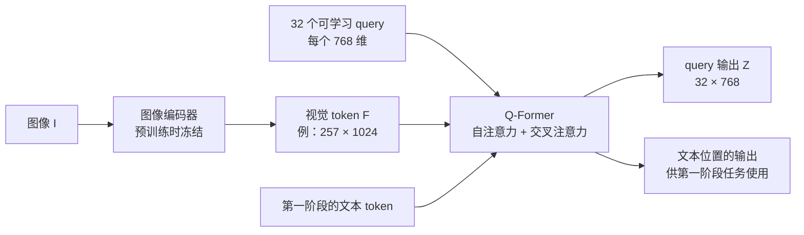
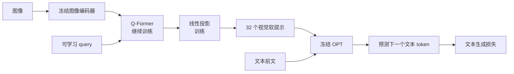
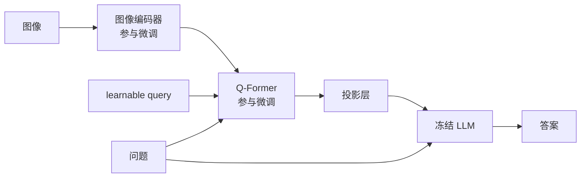

# BLIP-2 论文精讲讲义

> **核心问题：在不更新大型视觉模型和大型语言模型主体参数的情况下，怎样让语言模型可靠地利用图像信息？**
>
> **核心答案：用 Q-Former 提取少量与语言有关的视觉表示，再用两阶段训练，让这些表示既具有图文语义，又能被冻结的 LLM 用来生成文本。**

## 阅读说明

- **论文**：*BLIP-2: Bootstrapping Language-Image Pre-training with Frozen Image Encoders and Large Language Models*。
- **作者**：Junnan Li、Dongxu Li、Silvio Savarese、Steven Hoi，Salesforce Research。
- **发表**：ICML 2023，PMLR 202，19730–19742。
- **主依据**：用户提供的 [blip2.pdf](https://proceedings.mlr.press/v202/li23q/li23q.pdf)，共 13 页。下文“第 x 页”均指这份 PDF 的页码；正文为第 1–8 页，参考文献为第 9–11 页，补充表格和图示为第 12–13 页。
- **版本原则**：以这份论文中的实验、模型和结论为准。“最优”“SOTA”等表述均指论文当时比较的范围，不代表当前排名。
- **讲解约定**：“原文结论”“教学推导”“阅读评议”会明确区分。公式是按原文描述补写的教学表达，不冒充论文中带编号的原式；伪代码用于理解流程，不是可直接运行的复现。
- **显示建议**：使用支持 LaTeX 数学公式和 Mermaid 的 Markdown 阅读器。所有核心内容均在本文件内，图不显示时也可按配套文字阅读。

**建议先修**：知道 Transformer 的自注意力、交叉注意力、交叉熵和自回归生成即可。第 2 节也提供了最小补课。

**学习目标**：读完后应能画出 BLIP-2 的训练流程，解释 ITC/ITG/ITM 的注意力掩码，推导冻结 LLM 为什么仍可训练上游模块，并准确解读“8.7 个百分点”“54 倍”和“零样本”的含义。

## 目录与阅读路线

1. [先建立整篇论文的主线](#s1)
2. [读懂方法所需的最小背景](#s2)
3. [Q-Former：结构、维度与信息瓶颈](#s3)
4. [第一阶段：三种任务与三种注意力掩码](#s4)
5. [第二阶段：让冻结 LLM 使用视觉软提示](#s5)
6. [从一张猫的图片走完整个流程](#s6)
7. [预训练数据与训练配置](#s7)
8. [零样本 VQA：结果、口径与解释](#s8)
9. [消融实验：两阶段设计的证据](#s9)
10. [下游任务：描述、VQA 与检索](#s10)
11. [效率、参数量与结论边界](#s11)
12. [局限与批判性阅读](#s12)
13. [伪代码与实现时最容易犯的错](#s13)
14. [常见问题、练习与参考答案](#s14)
15. [复述提纲、原文索引与资料](#s15)

**30 分钟路线**：第 1、3、4.5、5.4、8、9、11 节。  
**系统精读路线**：按顺序阅读全文，最后完成第 14 节练习。  
**实现导向路线**：重点阅读第 3–5、7、10、13 节，并回查原文图 2、图 3、图 7。

<a id="s1"></a>
## 1. 先建立整篇论文的主线

### 1.1 这篇论文究竟想解决什么？

视觉领域已有能力很强的图像编码器，语言领域已有能生成流畅文本、具有一定知识和推理能力的 LLM。一个自然想法是：能不能把两者连接起来，直接获得多模态能力？

问题在于：**两个模型各自很强，不意味着它们的中间表示彼此可用。**

图像编码器输出的是视觉特征；LLM 习惯处理的是文本嵌入及其上下文关系。即使两个向量恰好具有相同维度，它们在数值分布和语义组织上也可能完全不同。这就是本文要处理的模态鸿沟。

如果端到端更新所有模型，计算和优化成本很高，还可能影响原有能力；如果把两个大模型都冻结，又必须把跨模态适配的工作交给中间模块。

BLIP-2 选择后一条路线：

$$
\text{图像}
\xrightarrow{\text{冻结图像编码器}}
\text{视觉特征}
\xrightarrow{\text{可训练 Q-Former}}
\text{紧凑视觉表示}
\xrightarrow{\text{可训练线性层}}
\text{视觉软提示}
\xrightarrow{\text{冻结 LLM}}
\text{文本}.
$$

来源：第 1–2 页 Introduction、第 3 节。

### 1.2 两阶段分别解决什么？

| 阶段 | 主要问题 | 训练信号 | 直观理解 |
|---|---|---|---|
| 第一阶段：视觉语言表示学习 | 从图像中提取什么，才与语言有关？ | 图文对比、图像条件文本生成、图文匹配 | 先学会提取适合语言任务的视觉信息 |
| 第二阶段：视觉到语言生成学习 | 怎样把这些信息表达成特定 LLM 能用的输入？ | 冻结 LLM 上的文本生成损失 | 再学会向这个 LLM 提供有效视觉条件 |

两个阶段都涉及图文关系，但训练的接口不同。第一阶段使用 Q-Former 自己的文本分支；第二阶段接入外部 LLM。

**不要把两阶段误解成“第一阶段学图像、第二阶段才接触文本”。第一阶段已经使用图文对和文本监督。**

### 1.3 怎样理解标题中的 Bootstrapping？

这里可以理解为：利用已经训练好的单模态模型，建立多模态能力。图像模型贡献视觉表征，LLM 贡献语言生成和已有知识，Q-Former 负责建立可用的连接。

这与第 7 节的数据处理也有联系：论文沿用 BLIP 的 CapFilt 思路，用模型生成和筛选描述，改善图文训练数据。

### 1.4 与相关工作的关键区别

以下概括依据本文第 2 页 Related Work，着眼于本文要解决的问题。

| 方法或路线 | 与 BLIP-2 的关系 | 阅读重点 |
|---|---|---|
| CLIP 一类图文对比方法 | 提供图文相似度学习的基础，也可提供视觉编码器 | 对齐相似度不等于建立可自由生成文本的多模态系统 |
| BLIP | 第一阶段的三种训练目标和数据处理受到它的启发 | BLIP-2 加入了冻结 LLM 的两阶段连接方案 |
| Frozen | 保持语言模型冻结，训练视觉侧使其输出成为软提示 | 证明了冻结语言模型仍可利用视觉条件这一方向 |
| Flamingo | 保持预训练语言模型主体冻结，引入新的交叉注意力层注入视觉信息 | BLIP-2 在 LLM 外部完成特征提取和输入适配 |
| BLIP-2 | 预训练时冻结视觉编码器与 LLM，以 Q-Former 和两阶段训练连接二者 | 同时解决信息选择与 LLM 接口适配 |

**贡献应整体理解为：模块设计、训练顺序和监督信号的配合。只记住“用了 32 个 query”会遗漏论文的主要论证。**

<a id="s2"></a>
## 2. 读懂方法所需的最小背景

### 2.1 图像编码器为什么输出一串 token？

以论文举例的 ViT-L/14 为例：输入分辨率为 `224 × 224`，每个 patch 为 `14 × 14`，于是每边有 16 个 patch，共 256 个；加上一个 CLS token，可得到 257 个视觉 token。

原文给出的特征形状是：

$$
F=E_{\mathrm{img}}(I)\in\mathbb{R}^{257\times1024}.
$$

这里每行都是一个视觉表示，不是一个已经识别好的单词。经过 ViT 的上下文建模，patch 表示也会包含周围乃至整张图的信息。

来源：第 3 页 3.1 节。以上 patch 数量计算为教学展开。

### 2.2 Self-attention 与 cross-attention 的区别

注意力的简化形式：

$$
\operatorname{Attn}(Q,K,V)
=\operatorname{softmax}\left(\frac{QK^\top}{\sqrt{d_k}}+M\right)V.
$$

- **Self-attention**：Q、K、V 来自同一个序列，用来让序列中的位置交换信息。
- **Cross-attention**：Q 来自一个序列，K、V 来自另一个序列，用来从另一组表示中读取信息。
- **Mask $M$**：决定哪些位置可以读取哪些位置；允许的位置加 0，禁止的位置加 $-\infty$。

BLIP-2 中，query 之间通过自注意力交流，query 通过交叉注意力读取图像。第一阶段的文本与 query 之间是否交流，则由自注意力掩码控制。

### 2.3 自回归生成与 teacher forcing

自回归模型把一句话的概率分解为：

$$
p(T\mid C)=\prod_{t=1}^{L}p(y_t\mid y_{<t},C),
$$

其中 $C$ 是条件，例如图像的视觉表示。训练时常用真实的前文预测下一个词，即 teacher forcing；推理时则使用自己此前生成的词。

因此，训练中可以把整句文本并行送入模型，但必须用因果掩码和正确的标签位移，保证预测当前目标时看不到未来答案。

### 2.4 冻结是什么意思？

“冻结”通常意味着不更新相应参数，不等于这个模块不参与计算，也不等于不能对它的输入求梯度。

例如固定函数 $f(x)=3x$，常数 3 不变，仍然有：

$$
\frac{\partial f}{\partial x}=3.
$$

同理，冻结 LLM 的权重之后，文本损失仍然可以通过 LLM 传回视觉软提示，进而更新投影层和 Q-Former。第 5.4 节会正式推导。

<a id="s3"></a>
## 3. Q-Former：结构、维度与信息瓶颈

### 3.1 先看整体结构

Q-Former 是 Querying Transformer。它把图像编码器输出的视觉 token，转换为固定数量的查询输出。



图中“文本 → Q-Former”是否能影响 query，要由具体任务的掩码决定。不能据此认为每个任务都会让 query 看到文本。

来源：第 3 页 3.1 节、图 2。

### 3.2 Learnable query 到底是什么？

设可学习查询矩阵为：

$$
U=[u_1,\ldots,u_m]^\top
\in\mathbb{R}^{m\times d_q},
\qquad m=32,\quad d_q=768.
$$

它是一组模型参数。一个 batch 中，各张图片通常从同一组初始 query 开始；经过与不同图像特征的交互后，得到不同的输出：

$$
Z(I)=\operatorname{QFormer}(U,F(I)).
$$

必须区分：

| 名称 | 含义 | 是否随图片变化？ |
|---|---|---|
| 初始 learnable query $U$ | 模型学习到的查询参数 | 推理时参数固定，通常跨图片共享 |
| 输出 query 表示 $Z(I)$ | 读取某张图后产生的特征 | 会变化 |
| 用户 question | 自然语言问题，如“猫戴了什么？” | 随问题变化 |
| 注意力公式中的 $Q$ | 当前层经线性映射形成的查询矩阵 | 随层和输入变化 |

虽然这些概念都与“query”有关，但不能混用。

**32 个 query 不是 32 个预先命名的物体槽，也没有被指定为“第一个负责猫、第二个负责眼镜”。** 可以用“多个信息读取位置”辅助理解，但论文没有证明每个位置必然形成固定、可解释的分工。

初始 query 参数量只有：

$$
32\times768=24{,}576.
$$

Q-Former 的主要参数量来自 Transformer 层，不能把 24,576 当作整个模块的规模。

### 3.3 它怎样读取图像？

假设某层 query 隐状态为 $H$，图像特征为 $F$。单头交叉注意力可以写成：

$$
Q_a=HW_Q,\qquad K_a=FW_K,\qquad V_a=FW_V,
$$

$$
A=\operatorname{softmax}\left(\frac{Q_aK_a^\top}{\sqrt{d_k}}\right),
\qquad O=AV_a.
$$

其中：

$$
A\in\mathbb{R}^{32\times N},\qquad
O\in\mathbb{R}^{32\times d_v}.
$$

每个 query 对 $N$ 个视觉 token 计算权重，再加权汇总信息。这是学习到的软选择，不是裁剪出 32 张小图，也不是简单平均池化。

实际模块还包含多头注意力、残差、归一化和前馈网络。这里的公式只展开信息读取这一核心步骤。

论文在**每隔一个 Transformer block**插入交叉注意力层。query 与文本共享自注意力层；文本位置本身不直接对图像特征做交叉注意力。因此，文本要获得图像信息，必须经由 query。

### 3.4 为什么叫“信息瓶颈”？

原文的维度比较：

$$
F\in\mathbb{R}^{257\times1024}
\quad\longrightarrow\quad
Z\in\mathbb{R}^{32\times768}.
$$

教学计算：

- token 数从 257 降为 32，约缩小 8 倍。
- 标量数从 263,168 降为 24,576，约缩小 10.7 倍。

但是，压缩本身不保证有用。关键是训练目标要求这 32 个位置保留对文本匹配和生成有价值的信息。

所以论文的信息瓶颈思想包含两部分：

1. 用固定数量的 query 限制输出容量。
2. 用图文任务决定优先保留哪些信息。

这里不是对图像做无损压缩，也没有证明严格的信息论最优性；原文没有把它写成带互信息正则项的变分信息瓶颈目标。

此外，**固定的是 Q-Former 输出 token 数，不是整个系统的计算量**。图像分辨率提高时，视觉 token 更多，图像编码器和交叉注意力仍可能更贵。

### 3.5 初始化与参数量

原文配置：

| 项目 | 配置 |
|---|---|
| 初始化 | 使用 BERT-base 的预训练权重 |
| 新增交叉注意力层 | 随机初始化 |
| query 数量 | 32 |
| query 隐藏维度 | 768 |
| 第一阶段完整 Q-Former 参数量 | 188M |

为什么利用 BERT 初始化？一种合理的教学解释是：文本分支和共享层可从已经学到的语言结构出发，避免所有参数都从零开始。不过，“比所有其他初始化都好”并不是本文通过系统消融证明的结论。

<a id="s4"></a>
## 4. 第一阶段：三种任务与三种注意力掩码

来源：第 3 页 3.2 节、图 2。这是整篇论文最需要精读的部分。

第一阶段不接入外部 LLM。图像编码器冻结，训练 Q-Former、learnable query 及相关任务头，让 query 学会提取与语言有关的图像信息。

三个任务共同使用图文对，但解决的问题不同：

| 目标 | 全称 | 核心问题 |
|---|---|---|
| ITC | Image-Text Contrastive Learning | 这张图在一批文本中最接近哪一句？ |
| ITG | Image-grounded Text Generation | 只依赖图像和已知前文，能否生成描述？ |
| ITM | Image-Text Matching | 这一个图文组合是否真正匹配？ |

### 4.1 先统一掩码的读法

设序列由 query 位置 $Q$ 和文本位置 $T$ 组成。注意：这里 $Q$ 表示一组位置，不是上一节公式中的投影矩阵 $Q_a$。

下文掩码中：

- **行表示正在读取信息的位置，列表示可被读取的位置。**
- 1 表示允许读取，0 表示禁止读取。
- 实际加入 attention logits 时，1 对应加 0，0 对应加 $-\infty$。
- $\mathbf{1}_{QT}$ 的含义是“query 行可读取 text 列”。
- 文本的因果掩码记为 $C$，在经过正确位移的 decoder 输入上为下三角矩阵。

这一约定非常重要：“文本读取 query”对应 $TQ$ 块，实际信息从 query 流向文本。

### 4.2 ITC：先建立可独立比较的图文表示

#### 为什么要禁止图文互看？

如果图像一侧的 query 提前读到了待匹配文本，就能利用文本本身构造“图像表示”，对比学习可能通过泄露答案走捷径。我们希望图像侧只看图、文本侧只看文本，再比较它们的语义。

因此使用单模态掩码：

$$
A_{\mathrm{ITC}}=
\begin{bmatrix}
\mathbf{1}_{QQ} & \mathbf{0}_{QT}\\
\mathbf{0}_{TQ} & \mathbf{1}_{TT}
\end{bmatrix}.
$$

query 之间可以双向交流，文本内部也可以双向交流，但二者互相不可见。图像信息仍然通过 query 的交叉注意力进入。

#### 相似度怎样计算？

一张图有 32 个输出 query，文本以 CLS 输出表示。设经过对比投影和归一化后：

$$
\hat z_{ik}=\operatorname{norm}(W_vz_{ik}),\qquad
\hat t_j=\operatorname{norm}(W_th_j^{\mathrm{CLS}}).
$$

图像 $i$ 与文本 $j$ 的分数为：

$$
s_{ij}=\max_{k=1,\ldots,32}\hat z_{ik}^{\top}\hat t_j.
$$

也就是：先计算每个 query 与文本的相似度，再取最大值，而不是先把 32 个 query 平均成一个向量。

教学解释：一句描述可能只涉及图像的一部分，max 聚合允许最相关的 query 提供匹配证据；这并不保证每个 query 都会形成稳定的物体语义。

#### 对比损失怎样写？

设 batch 有 $B$ 对图文，图像 $i$ 的正确文本是 $i$，温度为 $\tau$：

$$
p_{i\to t}(j\mid i)
=\frac{\exp(s_{ij}/\tau)}
{\sum_{r=1}^{B}\exp(s_{ir}/\tau)},
$$

$$
\mathcal L_{i\to t}
=-\frac1B\sum_{i=1}^{B}\log p_{i\to t}(i\mid i).
$$

反向同理：

$$
\mathcal L_{t\to i}
=-\frac1B\sum_{i=1}^{B}
\log\frac{\exp(s_{ii}/\tau)}
{\sum_{r=1}^{B}\exp(s_{ri}/\tau)},
$$

$$
\mathcal L_{\mathrm{ITC}}
=\frac{\mathcal L_{i\to t}+\mathcal L_{t\to i}}2.
$$

这是忽略标签平滑、多正样本等实现细节的教学形式。核心是正确配对的分数要高于 batch 内错误配对的分数。原文使用 batch 内负样本，没有沿用 BLIP 的 momentum queue。

### 4.3 ITG：逼 query 保留能够生成文本的信息

仅能分辨“猫图”和“汽车图”，不意味着已经编码了颜色、动作和物体关系。生成目标要求视觉表示足以支持更完整的描述。

ITG 的文本由 Q-Former 的文本分支生成，**此时不是外部 OPT 或 FlanT5 在生成**。

掩码为：

$$
A_{\mathrm{ITG}}=
\begin{bmatrix}
\mathbf{1}_{QQ} & \mathbf{0}_{QT}\\
\mathbf{1}_{TQ} & C
\end{bmatrix}.
$$

具体地说：

1. query 可以读取所有 query。
2. query 不能读取任何文本。
3. 文本可以读取所有 query。
4. 文本只能读取符合因果顺序的文本前文。

为什么 query 不能读文本？否则 query 可能吸收训练描述中的未来词，再把答案回传给预测位置。这样生成任务就不再要求 query 从图像中提取必要信息。

其教学损失：

$$
\mathcal L_{\mathrm{ITG}}
=-\sum_{t=1}^{L}
\log p_\theta(y_t\mid y_{<t},Z(I)).
$$

原文用新的 `[DEC]` token 替换首位的 `[CLS]`，表示当前进行的是解码任务。

**关键路径**：

$$
\text{图像特征}
\longrightarrow\text{query}
\longrightarrow\text{文本位置}
\longrightarrow\text{词预测}.
$$

因为文本位置不能直接读取视觉特征，query 就必须承担信息传递工作。

### 4.4 ITM：让图文充分交互，再判断细节是否匹配

ITC 适合快速比较，但两边独立编码，难以充分核查细节。比如图中是“猫戴太阳镜”，候选文本却写“猫戴帽子”，二者都属于猫图，粗粒度相似度可能仍然很高。

ITM 因此使用全双向掩码：

$$
A_{\mathrm{ITM}}=
\begin{bmatrix}
\mathbf{1}_{QQ} & \mathbf{1}_{QT}\\
\mathbf{1}_{TQ} & \mathbf{1}_{TT}
\end{bmatrix}.
$$

图文可以充分交流，再判断这一个配对是否成立。此时 query 输出已经依赖图像与文本：

$$
Z_{\mathrm{ITM}}=Z(I,T).
$$

对每个输出 query 使用两类线性分类头，先得到 logits，再跨 query 求平均：

$$
\ell_k=W_{\mathrm{itm}}z_k+b_{\mathrm{itm}}
\in\mathbb R^2,
\qquad
\bar\ell=\frac1{32}\sum_{k=1}^{32}\ell_k,
$$

$$
p_{\mathrm{match}}=\operatorname{softmax}(\bar\ell)_1.
$$

对正负配对优化交叉熵。**原文是平均 logits，不是先算概率再平均。**

负例也不是一味随机取很容易区分的图片，而采用难负例挖掘：寻找模型觉得相似但实际上不匹配的组合，提高细粒度辨别要求。

ITM 中看到候选文本是合法的，因为任务本来就是判断这个组合；它与 ITC/ITG 中的信息泄露问题不同。

### 4.5 一张表记住三种任务

| 任务 | query 读 query | query 读文本 | 文本读 query | 文本读文本 | 输出用途 |
|---|---|---|---|---|---|
| ITC | 双向 | 禁止 | 禁止 | 双向 | 图文相似度 |
| ITG | 双向 | 禁止 | 允许 | 因果 | 自回归文本 |
| ITM | 双向 | 允许 | 允许 | 双向 | 匹配二分类 |

**记忆方式**：

- ITC：分别理解，再比较。
- ITG：视觉先进入 query，文本再据此生成。
- ITM：放在一起，核查是否对应。

三者共同约束“提取什么”：

$$
\mathcal L_{\mathrm{stage1}}
=\mathcal L_{\mathrm{ITC}}
+\mathcal L_{\mathrm{ITG}}
+\mathcal L_{\mathrm{ITM}}.
$$

联合训练不意味着三个任务完全合并成同一个注意力前向过程：它们共享模型参数，却使用不同掩码和输出头。

### 4.6 为什么要同时需要三种目标？

| 单个目标擅长什么？ | 单独使用时可能不足什么？ | 另一个目标怎样补充？ |
|---|---|---|
| ITC：建立独立表示和全局对应关系 | 不必完整编码生成描述所需的细节 | ITG 要求信息足够生成文本 |
| ITG：保留可描述的内容 | 生成损失也可能被语言统计规律部分满足 | ITC、ITM 直接施加图文对应约束 |
| ITM：验证具体配对的细节 | 每对都做融合计算，不能直接高效检索全库 | ITC 可先独立编码并筛选候选 |

这是对目标互补性的机制解释。后文图 5 支持第一阶段整体有益，表 6 支持 ITG 对检索微调有益；不要据此声称本文已经完成所有目标组合的全面预训练消融。

<a id="s5"></a>
## 5. 第二阶段：让冻结 LLM 使用视觉软提示

来源：第 4 页 3.3 节、图 3。

### 5.1 第一阶段结束后，还缺少什么？

Q-Former 学到的表示已经与语言任务有关，但它是在 Q-Former 自己的文本分支和任务头下学到的，不保证外部 LLM 立即能用。

例如：一个视觉向量可能表达了“猫戴着太阳镜”，但 OPT 的输入空间并没有被训练为直接识别这个向量。第二阶段要通过实际的 LLM 生成损失来适配接口。

设：

$$
Z\in\mathbb R^{32\times768},
\qquad
P=ZW_p+b_p\in\mathbb R^{32\times d_{\mathrm{LLM}}},
$$

其中 $W_p$ 是可训练的全连接投影层，$d_{\mathrm{LLM}}$ 是所选 LLM 的输入嵌入维度。

$P$ 就是 soft visual prompts，中文可译为“视觉软提示”。

它们是一串连续向量，通常不对应词表中的某个离散单词。因此第二阶段不是先把图像翻译成一段固定 caption，再把 caption 交给 LLM；它把连续视觉表示直接作为 LLM 输入的一部分。

**线性层解决输入维度接口；Q-Former 与投影层共同接受生成训练，解决语义可用性。只把维度改对，并不等于完成对齐。**

### 5.2 接入 decoder-only LLM：OPT

输入嵌入序列可示意为：

```text
[视觉软提示 p1 ... p32] [文本 token 的嵌入 e1 ... eL]
```

生成时，文本 token 在因果结构下读取前面的视觉软提示和文本前文：

$$
\mathcal L_{\mathrm{stage2,OPT}}
=-\sum_{t=1}^{L}
\log p_{\phi}(y_t\mid y_{<t},P(I)).
$$

其中 $\phi$ 表示冻结的 OPT 参数。优化变量包括 Q-Former、learnable query 和投影层。

训练目标是文本位置的词预测，不是让模型生成“第一个视觉 token”或重建图像。视觉软提示位置本身不作为词表预测目标。



虽然图里只画了向前的箭头，训练时损失会通过 OPT 回传到投影层和 Q-Former。OPT 的权重不更新。

### 5.3 接入 encoder-decoder LLM：FlanT5

原文对这类模型采用 prefix language modeling：把一段文本分为前缀 $T_{\mathrm{pre}}$ 和后缀 $T_{\mathrm{suf}}$。

例如：

```text
完整文本：a cat wearing sunglasses
前缀：    a cat
后缀：    wearing sunglasses

Encoder 输入：[视觉软提示] [前缀文本嵌入]
Decoder 目标：生成后缀文本
```

其条件生成可写为：

$$
H_{\mathrm{enc}}
=\operatorname{Enc}_{\phi}([P(I);E(T_{\mathrm{pre}})]),
$$

$$
\mathcal L_{\mathrm{stage2,T5}}
=-\sum_{t=1}^{|T_{\mathrm{suf}}|}
\log p_{\phi}
\left(y_t^{\mathrm{suf}}
\mid y_{<t}^{\mathrm{suf}},H_{\mathrm{enc}}\right).
$$

两种 LLM 的主要区别：

| 项目 | OPT | FlanT5 |
|---|---|---|
| 结构 | decoder-only | encoder-decoder |
| 视觉表示放在哪里？ | 作为文本前面的输入嵌入 | 作为 encoder 输入的一部分 |
| 原文第二阶段目标 | 图像条件语言建模 | 给定视觉与文本前缀，生成后缀 |
| 原有语言训练特点 | 本文使用未做指令调优的 OPT 系列 | 本文使用经过指令调优的 FlanT5 系列 |

“FlanT5 在这里表现更好”不能单独证明 encoder-decoder 架构优于 decoder-only，因为两者的指令训练、数据与规模也不同。

### 5.4 冻结 LLM，梯度到底怎样回传？

这是理解 BLIP-2 训练机制的关键。

令：

$$
F=E_{\psi}(I),\qquad
Z=g_{\theta}(U,F),\qquad
P=h_{\omega}(Z),\qquad
\mathcal L=\operatorname{CE}(\operatorname{LLM}_{\phi}(P,T_{\mathrm{in}}),T_{\mathrm{target}}).
$$

预训练时：

- $\psi$：图像编码器参数，冻结。
- $\phi$：LLM 参数，冻结。
- $\theta$：Q-Former 参数，训练。
- $U$：learnable query，训练。
- $\omega$：投影层参数，训练。

链式法则给出：

$$
\frac{\partial\mathcal L}{\partial\theta}
=
\frac{\partial\mathcal L}{\partial P}
\frac{\partial P}{\partial Z}
\frac{\partial Z}{\partial\theta}.
$$

其中：

$$
\frac{\partial\mathcal L}{\partial P}
=
\frac{\partial\mathcal L}{\partial\,\operatorname{LLM}_{\phi}}
\frac{\partial\,\operatorname{LLM}_{\phi}}{\partial P}.
$$

LLM 的权重虽然固定，它对输入 $P$ 的导数通常仍然存在，所以可以训练上游模块。

实现层面最重要的区别：

```python
# 含义示意：冻结 LLM 权重
for parameter in llm.parameters():
    parameter.requires_grad = False

# 训练时仍正常前向，使 loss 可以对 visual_prompts 求导
output = llm(inputs_embeds=visual_and_text_embeddings)
loss = text_generation_loss(output, text_targets)
loss.backward()
```

若在训练时把整个 LLM 前向放进 `torch.no_grad()`，就会切断这条上游梯度路径。相反，视觉编码器位于可训练 Q-Former 之前，冻结且没有其他需要梯度的上游输入时，可以在不构建它的反向图的情况下先取得特征。

这也解释了为什么“冻结 LLM”并不意味着“只付一次前向的代价”：训练上游软提示仍需要通过 LLM 计算输入梯度，具体显存与算力收益取决于实现。

### 5.5 两个阶段的“语言监督”究竟有什么不同？

| 对比点 | 第一阶段 ITG | 第二阶段生成训练 |
|---|---|---|
| 谁预测文本？ | Q-Former 自己的文本分支 | 外部冻结 LLM |
| 文本信息怎样取得图像条件？ | 文本通过自注意力读取 query | LLM 读取投影后的视觉软提示 |
| 主要学什么？ | 提取足以支持语言描述的视觉信息 | 把这些信息转换为所选 LLM 能利用的条件 |
| 是否存在 ITC/ITM 联合目标？ | 第一阶段联合使用 | 本文第二阶段主要使用生成目标 |

第一阶段提供有用的表示起点，第二阶段适配具体 LLM。这是图 5 的消融实验要检验的核心设计。

<a id="s6"></a>
## 6. 从一张猫的图片走完整个流程

假设图像是“一只戴太阳镜的猫”，训练描述为 `a cat wearing sunglasses`。

### 6.1 第一阶段：同一图文对接受三种约束

1. **取特征**：冻结的视觉编码器输出 patch/CLS 表示。
2. **ITC**：query 只读图像，文本分支只读描述；正确图文应比“汽车在路上”等错误配对更相似。
3. **ITG**：输入 `[DEC]` 和真实文本前文，通过 query 提供的图像信息，依次预测描述中的词。预测“sunglasses”时不能直接看到目标答案。
4. **ITM**：将图像与描述共同输入；与“a cat wearing a hat”等难负例比较，判断具体组合是否匹配。
5. **联合更新**：三项损失共同改变 query、Q-Former 和任务头，图像编码器参数保持固定。

### 6.2 第二阶段：把视觉证据交给冻结 LLM

1. 继承第一阶段学到的 query 和相关 Q-Former 参数。
2. Q-Former 读取图片，输出 32 个视觉表示。
3. 投影层把它们转换到 LLM 的嵌入维度。
4. LLM 根据这些连续提示生成描述或文本后缀。
5. 生成错误通过冻结 LLM 回传，更新 Q-Former 和投影层。

### 6.3 零样本提问时会发生什么？

例如给出：

```text
Question: What is the cat wearing? Short answer:
```

对 FlanT5，视觉软提示与问题文本进入 encoder，decoder 生成答案。此时不依赖针对这个 VQA 数据集的监督微调。

不要把这条路径和论文的**监督 VQA 微调结构**混淆。在监督微调中，问题还会输入 Q-Former，指导它提取与问题有关的视觉信息；见第 10.2 节与原文图 7。

<a id="s7"></a>
## 7. 预训练数据与训练配置

来源：第 4 页 3.4 节。这里的数字用于理解论文实验规模，并不表示普通设备复现也需要或能够完全照做。

### 7.1 数据规模：129M 图像

原文使用与 BLIP 相同的预训练数据集合，共约 1.29 亿张图像，包含：

- COCO、Visual Genome。
- CC3M、CC12M、SBU。
- 从 LAION400M 中选取的 115M 图像。

**115M 是 LAION 子集规模，129M 是总规模。** 也不要把“129M 图像”简单等同于“只有 129M 条固定文本”，因为数据处理会为图像保留多个描述。

### 7.2 CapFilt：训练文本也经过构造与筛选

论文的数据处理过程：

1. 对网络图片，用 BLIP-large 描述模型生成 10 条候选 caption。
2. 将候选 caption 与原始网页 caption 一起排序。
3. 使用 CLIP ViT-L/14 的图文相似度评价候选。
4. 每张图保留排名最高的 2 条。
5. 每次预训练抽取其中一条文本。

因此，实验效果来自模型和训练策略，也依赖较大规模且经过清洗的图文数据。不能把所有收益都归因于 Q-Former 结构本身。

### 7.3 视觉编码器与语言模型

| 类型 | 论文使用的模型 |
|---|---|
| 图像编码器 | 来自 CLIP 的 ViT-L/14；来自 EVA-CLIP 的 ViT-g/14 |
| decoder-only LLM | OPT-2.7B、OPT-6.7B |
| encoder-decoder LLM | FlanT5-XL、FlanT5-XXL |

视觉侧使用 ViT 倒数第二层输出，原文报告比使用最后层略好。

这里两个视觉模型本身来自图文预训练体系。论文的“单模态模型”主要按当前模块功能区分，不能据此声称图像编码器从未利用过文本监督。

### 7.4 原文预训练超参数

| 项目 | 第一阶段 | 第二阶段 |
|---|---|---|
| 训练步数 | 250k | 80k |
| batch size | ViT-L：2320；ViT-g：1680 | OPT：1920；FlanT5：1520 |
| 图像分辨率 | 224 × 224 | 224 × 224 |
| 优化器 | AdamW | AdamW |
| AdamW 参数 | $\beta_1=0.9,\ \beta_2=0.98$ | 同左 |
| weight decay | 0.05 | 0.05 |
| 峰值学习率 | $10^{-4}$ | $10^{-4}$ |
| warmup | 2k steps | 2k steps |
| 学习率调度 | cosine decay | cosine decay，最小学习率 $5\times10^{-5}$ |
| 数据增强 | random resized crop、水平翻转 | 同左 |

原文第 4 页将第二个 AdamW 系数也印成了 $\beta_1$，本表按标准含义记为 $\beta_2$。

冻结模型采用低精度：视觉编码器和 OPT 使用 FP16，FlanT5 使用 BF16。论文报告相较 32 位未见性能下降。

最大配置使用 16 张 A100 40GB：第一阶段少于 6 天，第二阶段少于 3 天。这个结果说明相对大型端到端训练更节省成本，仍然属于较大的研究训练规模。

### 7.5 下游微调超参数速查

来源：第 12 页表 7–9。各任务均训练 5 epochs，warmup 1000 steps，weight decay 0.05，drop path 0。

| 任务 | 分辨率 | batch size | 学习率 | 其他要点 |
|---|---|---|---|---|
| COCO captioning | 364 | 256 | $10^{-5}$ | 提示为 `a photo of`；推理 beam size 5；AdamW $(0.9,0.999)$ |
| VQA | 490 | 128 | $10^{-5}$ | 提示为 `Question: {} Answer:`；推理 beam size 5；AdamW $(0.9,0.999)$ |
| 图文检索 | 364 | 224 | ViT-L：$5\times10^{-6}$；ViT-g：$10^{-5}$ | ViT-L 的 AdamW 为 $(0.9,0.98)$，ViT-g 为 $(0.9,0.999)$ |

ViT 的逐层学习率衰减：

- Captioning：FlanT5-XL / OPT-2.7B / OPT-6.7B 分别为 1 / 1 / 0.95。
- VQA：上述三个配置分别为 0.95 / 0.95 / 0.9。
- 检索：ViT-L / ViT-g 分别为 1 / 0.95。

复现时还需结合对应模型、数据划分和官方训练配置；这张表不是完整复现清单。

<a id="s8"></a>
## 8. 零样本 VQA：结果、口径与解释

来源：第 6 页 4.1 节、表 2。

### 8.1 这里的“零样本”是什么？

VQA 即 Visual Question Answering：给一张图和一个问题，生成答案。

本文的零样本 VQA 指：经过通用图文预训练后，不再针对相应 VQA 任务做监督微调，直接通过提示生成答案。**不是模型没有训练，也不是没有用过图文数据。**

同时，预训练数据包含 COCO、Visual Genome 等图像来源。没有进一步重叠分析时，不能把“零样本 VQA”扩展解释为“所有测试图像都绝对未在任何预训练阶段出现过”。

提示与解码：

| 模型 | 提示 |
|---|---|
| OPT | `Question: {} Answer:` |
| FlanT5 | `Question: {} Short answer:` |

论文使用 beam search，beam width 为 5，length penalty 为 -1，以鼓励更短、更接近人工标注形式的答案。

提示与输出长度会影响分数。把提示改变后得到的指标直接和表 2 对比，需要保持谨慎。

### 8.2 核心结果摘录

以下均为表 2；VQAv2 列使用 test-dev，OK-VQA 使用 test，GQA 使用 test-dev。

| 模型 | 可训练参数 | 总参数 | VQAv2 | OK-VQA | GQA |
|---|---:|---:|---:|---:|---:|
| Flamingo-80B | 10.2B | 80B | 56.3 | **50.6** | 未报 |
| BLIP-2 ViT-L + OPT-2.7B | 104M | 3.1B | 49.7 | 30.2 | 33.9 |
| BLIP-2 ViT-g + OPT-2.7B | 107M | 3.8B | 52.3 | 31.7 | 34.6 |
| BLIP-2 ViT-g + OPT-6.7B | 108M | 7.8B | 52.6 | 36.4 | 36.4 |
| BLIP-2 ViT-L + FlanT5-XL | 103M | 3.4B | 62.3 | 39.4 | 44.4 |
| BLIP-2 ViT-g + FlanT5-XL | 107M | 4.1B | 63.0 | 40.7 | 44.2 |
| BLIP-2 ViT-g + FlanT5-XXL | 108M | 12.1B | **65.0** | 45.9 | **44.7** |

注意不要把 VQAv2 validation 的 65.2 和 test-dev 的 65.0 混在一起使用。

### 8.3 “提升 8.7%”应该怎样表述？

论文摘要的比较对应：

$$
65.0-56.3=8.7.
$$

更准确的中文表述是：**VQAv2 test-dev 得分提高 8.7 个百分点**。

相对增幅则约为：

$$
\frac{65.0-56.3}{56.3}\times100\%\approx15.5\%.
$$

二者不是同一个数字。VQA accuracy 本身也不是简单的单一答案 exact match，它考虑了人工答案共识。

### 8.4 更强的视觉编码器与 LLM 是否有帮助？

从表中能看到总体趋势：

- 固定 OPT-2.7B，将 ViT-L 换成 ViT-g，VQAv2 从 49.7 到 52.3。
- 固定 ViT-g，将 FlanT5-XL 换成 XXL，VQAv2 从 63.0 到 65.0。
- 本文使用的 FlanT5 配置在零样本 VQA 上明显优于对应 OPT 配置。

这些结果支持模块化方案能够利用更强的组件，但**不保证每个指标都单调提高**。例如 ViT-L → ViT-g、FlanT5-XL 的 GQA 分数是 44.4 → 44.2。

FlanT5 与 OPT 的差异还混合了指令调优、训练数据和模型结构等因素，不能把分差全部归因于其中一个因素。

### 8.5 为什么 OK-VQA 没有超过 Flamingo？

OK-VQA 更强调开放世界知识。论文作者推测，Flamingo 使用的 70B Chinchilla 比 BLIP-2 使用的 11B FlanT5-XXL 具有更多相关知识，因此 Flamingo 在这里更强。

这是一种**作者提出的解释**，不是控制了全部变量后的因果结论。

这一结果也说明：视觉语言对齐做得更好，并不自动等于事实知识更丰富。

<a id="s9"></a>
## 9. 消融实验：两阶段设计的证据

### 9.1 图 5 检验了什么？

来源：第 6–7 页 4.1 节、图 5。

对比两种训练起点：

1. 先经过第一阶段的表示学习，再进行第二阶段生成训练。
2. 跳过第一阶段，直接靠连接冻结 LLM 后的生成损失学习。

图中横轴是第二阶段训练步数，纵轴是零样本 VQAv2 分数；左侧使用 OPT-6.7B，右侧使用 FlanT5-XL。

**观察**：

- 有第一阶段时，两类 LLM 的 VQA 分数都显著更高。
- 没有第一阶段时，OPT 的分数随第二阶段训练明显下降。
- FlanT5 在没有第一阶段时仍有一定改善，但明显低于经过第一阶段的版本。

这些曲线支持：在本文配置与训练预算下，先学习语言相关视觉表示，能够显著改善后续生成学习。它们并不证明所有视觉语言系统在任何数据和训练预算下都必须采用相同的两阶段方案。

### 9.2 原文说“灾难性遗忘”，冻结参数为什么还会退化？

原文把没有第一阶段时 OPT 的退化称为 catastrophic forgetting。

需要同时记住两个事实：

1. LLM 权重在这里没有更新。
2. 上游 Q-Former 和软提示发生变化，因而整个多模态系统的条件输入也发生变化。

因此，阅读时不应将这条曲线解释成“OPT 的原始权重被覆盖了”。更严谨的描述是：**多模态系统在视觉条件下的任务表现退化**。图 5 直接测量的是零样本 VQA，不是一个全面的纯文本能力保持测试。

为什么单靠生成损失可能不够？一种教学解释是：生成目标可以部分依靠语言先验降低损失，却没有保证上游始终学习到可泛化、细粒度的视觉对应关系。第一阶段的对比和匹配约束提供了更明确的视觉语言学习信号。

后一段属于机制解释，图 5 没有单独验证其中每一种优化原因。

### 9.3 表 6：ITG 对检索也有帮助吗？

来源：第 8 页表 6。对比的是 **COCO 检索微调目标**：

| 微调目标 | 图 → 文 R@1 | 图 → 文 R@5 | 文 → 图 R@1 | 文 → 图 R@5 |
|---|---:|---:|---:|---:|
| ITC + ITM | 84.5 | 96.2 | 67.2 | 87.1 |
| ITC + ITM + ITG | 85.4 | 97.0 | 68.3 | 87.7 |

加入 ITG 后，R@1 分别提高 0.9 和 1.1 个百分点。这支持“生成监督能促使 query 提取更适合语言任务的视觉特征”这一设计动机。

**证据边界**：它不是“从预训练起完全去掉 ITG”的实验，也不是单独证明 ITG 解释了 BLIP-2 全部收益。

<a id="s10"></a>
## 10. 下游任务：描述、VQA 与检索

### 10.1 图像描述：LLM 冻结，视觉编码器参与微调

来源：第 7 页 4.2 节、表 3。

模型在 COCO 上进行 captioning 微调，使用提示 `a photo of` 和文本生成交叉熵损失。**这一阶段更新图像编码器与 Q-Former，LLM 保持冻结**，连接投影层也属于适配部分。

评估有两个不同设置：

- **COCO**：在该数据集上训练后，在对应测试集评估。
- **NoCaps**：将在 COCO 上微调的模型迁移过去评估，属于跨数据集零样本迁移。

因此，NoCaps 表中的“Zero-shot”不表示模型从未进行 captioning 微调。

表 3 部分结果：

| 模型 | NoCaps overall CIDEr | NoCaps overall SPICE | COCO BLEU@4 | COCO CIDEr |
|---|---:|---:|---:|---:|
| BLIP | 113.2 | 14.8 | 40.4 | 136.7 |
| BLIP-2 ViT-g + OPT-2.7B | 119.7 | 15.4 | 43.7 | 145.8 |
| BLIP-2 ViT-g + OPT-6.7B | 121.0 | 15.3 | 43.5 | 145.2 |
| BLIP-2 ViT-g + FlanT5-XL | 121.6 | 15.8 | 42.4 | 144.5 |

指标的直观含义：

| 指标 | 大致关注什么？ | 阅读时要注意 |
|---|---|---|
| CIDEr | 与人工参考描述的共识，使用带权 n-gram 匹配 | 高分不保证每条描述都没有事实错误 |
| SPICE | 物体、属性和关系等语义结构是否匹配 | 与 n-gram 指标衡量的侧重点不同 |
| BLEU@4 | 四阶及以下 n-gram 的匹配情况 | 不能直接和 CIDEr 数值横向比较 |

同样不能说“更大的 LLM 在每个指标上都更好”：OPT-6.7B 的 COCO CIDEr 为 145.2，略低于 OPT-2.7B 的 145.8。

### 10.2 监督 VQA：问题会进入 Q-Former

来源：第 7 页 4.3 节、表 4；第 13 页图 7。

零样本路径中，先从图像提取视觉表示，再把视觉提示和问题交给 LLM。监督 VQA 微调进一步让问题参与视觉特征提取：

$$
Z=Z(I,\text{question}).
$$



问题出现两次有不同作用：

1. **进入 Q-Former**：通过共享自注意力影响 query，使其读取与问题更相关的视觉内容。
2. **进入 LLM**：说明应该回答什么，而不只是描述图像。

例如问“猫戴了什么”，与问“猫旁边有什么”，适合提取的视觉信息并不完全一样。

原文使用 VQAv2 的训练与验证部分，以及 Visual Genome 的训练样本。表 4 报告：

| 模型 | VQAv2 test-dev |
|---|---:|
| Flamingo-80B | 82.10 |
| BLIP-2 ViT-g + FlanT5-XL | 81.66 |
| BLIP-2 ViT-g + OPT-2.7B | 81.74 |
| BLIP-2 ViT-g + OPT-6.7B | **82.30** |
| BEIT-3，封闭答案分类模型 | 84.03 |

BLIP-2 在表中的开放式答案生成模型里表现很强，但**不是超过表内所有封闭答案分类模型**。分类模型在预定义答案集合中选择，开放式模型生成文本，两类设置应分别比较。

零样本时 FlanT5 更强，监督微调后 OPT-6.7B 配置更强，也说明评估方式和监督条件会改变模型之间的相对表现。

### 10.3 图文检索：直接用第一阶段模型，不需要 LLM

来源：第 8 页 4.4 节、表 5。

检索的目标是排序，不要求生成文本。因此从第一阶段模型出发，微调 Q-Former 与图像编码器，继续使用 ITC、ITM、ITG；不必接入外部 LLM。

推理分两步：

$$
\text{ITC 独立编码并计算相似度}
\longrightarrow
\text{选取前 }k=128\text{ 个候选}
\longrightarrow
\text{根据 ITM 分数重排序}.
$$

为什么不用 ITM 对全库逐一判断？因为融合计算需要依赖具体图文组合；ITC 可以预计算表示并做较快的全局筛选。

表 5 的部分结果：

| 模型 | Flickr30K 图 → 文 R@1 | Flickr30K 文 → 图 R@1 | COCO 图 → 文 R@1 | COCO 文 → 图 R@1 |
|---|---:|---:|---:|---:|
| BLIP | 96.7 | 86.7 | 82.4 | 65.1 |
| BLIP-2 ViT-L | 96.9 | 88.6 | 83.5 | 66.3 |
| BLIP-2 ViT-g | **97.6** | **89.7** | **85.4** | **68.3** |

这里模型先在 COCO 上微调，再零样本迁移到 Flickr30K。Flickr30K 使用 1K 测试设置，COCO 使用 5K 测试设置，不能忽略候选规模直接比较两个数据集的数值。

R@K 表示：正确匹配项是否进入前 K 个结果。图 → 文有时写作 TR，文 → 图有时写作 IR。

### 10.4 一张表理清“谁被冻结”

| 训练场景 | 图像编码器 | Q-Former / query | 投影层 | 外部 LLM |
|---|---|---|---|---|
| 第一阶段预训练 | 冻结 | 训练 | 尚不需要接 LLM 的投影 | 不接入 |
| 第二阶段预训练 | 冻结 | 训练 | 训练 | 冻结 |
| Captioning 微调 | 训练 | 训练 | 训练 | 冻结 |
| 监督 VQA 微调 | 训练 | 训练，并接收问题 | 训练 | 冻结 |
| 检索微调 | 训练 | 训练 | 不使用 LLM 投影 | 不接入 |

表中省略了归一化层、任务头等细节，目的是辨别主干的训练策略。

**“BLIP-2 使用冻结模型”描述的是核心预训练策略，不能推导成所有任务中每个组件都永久冻结。**

<a id="s11"></a>
## 11. 效率、参数量与结论边界

### 11.1 为什么同时出现 188M 和约 108M？

原文第 3 页说明完整 Q-Former 约为 188M；第 6 页表 1 用 188M 概括 BLIP-2 的预训练可训练规模；同页表 2 的各生成配置则报告约 103M–108M。

理解这个差别，需要区分：

- 第一阶段需要文本嵌入、文本处理分支及相应任务组件。
- 第二阶段主要保留提取图像 query 表示的路径，再加上连接 LLM 的适配参数。

官方 OPT 实现中确实删除了 Q-Former 的文本词嵌入、位置嵌入、文本生成头及文本路径中的部分组件，保留 query 路径。这为统计口径的差异提供了实现依据。具体计数还受投影层和模型配置影响，不能只靠“188 减去某个固定常数”得到所有行。[官方 OPT 实现](https://github.com/salesforce/LAVIS/blob/main/lavis/models/blip2_models/blip2_opt.py)

所以两个数字不应混用：一个对应完整第一阶段模块，另一个对应表 2 中具体生成模型的可训练规模。

### 11.2 “54 倍更少可训练参数”怎么算？

摘要的比较可以由表 1 的口径重现：

$$
\frac{10.2\mathrm{B}}{188\mathrm{M}}
\approx54.3.
$$

也就是 Flamingo 的 10.2B 可训练参数约为 BLIP-2 的 54 倍。

若改用表 2 的 108M，会得到约 94.4 倍；这不是摘要中“54 倍”使用的口径。引用原文时应把分母说明清楚。

### 11.3 可训练参数少，为什么仍需要很大显存？

BLIP-2 ViT-g + FlanT5-XXL 在表 2 中总参数约为 12.1B。冻结参数仍然需要存储，LLM 仍要参与前向计算；训练时还需要计算软提示的输入梯度。

以每参数 2 字节粗估：

$$
12.1\times10^9\times2
\approx24.2\times10^9\text{ bytes}.
$$

这只是十进制约 24.2 GB 的**权重存储估计**，不包含激活、缓存、可训练参数的优化器状态和运行时开销，也不是完整显存需求。

冻结减少的主要负担包括大量权重的梯度与优化器状态，以及相应参数更新；紧凑视觉 token 也减少了送入 LLM 的视觉前缀长度。但不能将参数比例直接解释为训练时间、显存或推理延迟的同比例下降。

### 11.4 应该如何评价论文的效率贡献？

合理结论是：**通过复用预训练大模型、缩小需要优化的部分，BLIP-2 显著改善了多模态预训练的适配成本。**

仍需明确三点：

1. 被复用的视觉模型与 LLM 本身已经付出了大量预训练成本。
2. 两阶段训练和数据清洗仍然需要计算。
3. 模块化意味着可以利用更强的组件，但更换新 LLM 时通常还需重新适配，不能只替换文件就保证性能。

### 11.5 论文支持什么、不足以支持什么？

| 证据 | 可以支持的结论 | 不能直接推出 |
|---|---|---|
| 表 2 的高分 | 论文设置下零样本 VQA 很强 | 全部视觉语言任务都更好 |
| 图 5 的消融 | 第一阶段改善本文第二阶段训练 | 所有系统都必须用同样的第一阶段 |
| 表 6 的消融 | ITG 对本文检索微调有益 | ITG 单独解释了全部性能优势 |
| 表 3、表 5 的迁移结果 | 具备较强跨数据集迁移能力 | 从未使用过任何相关来源的数据 |
| 冻结主干、少量可训练参数 | 参数适配成本较低 | 总模型小、全部成本同比降低 |
| 图 4 的例子 | 展示指令控制与视觉对话的可能性 | 已经系统验证了广泛可靠的视觉推理 |

<a id="s12"></a>
## 12. 局限与批判性阅读

来源：第 8 页 Limitation；第 12 页失败案例图 6。

### 12.1 没有观察到预期的多模态 in-context learning 收益

论文尝试在上下文中给出 VQA 示例，但没有观察到 VQA 性能改善。

作者推测原因与训练样本组织方式有关：每个样本通常只有单个图文对，模型没有在训练中充分学习多组图文示例之间的关联。

例如真正的多模态 few-shot 任务可能要求：

```text
图片 A + 问题 A + 答案 A
图片 B + 问题 B + 答案 B
图片 C + 问题 C → 预测答案 C
```

这与“一张图配一句描述”的预训练分布不同。该解释是作者的归因，不是本文通过仅改变数据组织方式就完全验证的结论。

尤其要区分：**能通过拼接历史文本进行视觉对话，不等于已经具备有效的多模态上下文示例学习能力。**

### 12.2 看懂图片不保证知识与推理正确

附录图 6 给出三类错误：

| 失败类型 | 原文案例的含义 | 暴露的问题 |
|---|---|---|
| 知识不准确 | 为人物生成了一句属于别人的名言 | 识别人像和正确调用事实知识是两回事 |
| 推理路径不合适 | 回答加拿大 12 月的着装问题时，关注正式程度而忽略天气 | 识别衣服不等于抓住决策相关条件 |
| 信息未更新 | 对新手机给出旧型号及具体规格 | 视觉相似和旧知识可能导致自信编造 |

这些例子说明，连接视觉输入不会自动校正 LLM 的全部事实知识，也不会自动保证推理过程合理。

### 12.3 32 个 query 可能遗漏哪些信息？

**阅读评议**：固定的视觉输出预算很适合控制 LLM 输入长度，但在细粒度任务中可能出现信息竞争，例如密集文字、很多小物体或复杂空间关系。

这是由结构产生的合理关注点，不是本文已经系统证明“BLIP-2 不会 OCR”或“32 一定不足”的结论。论文没有提供完整的 query 数量、所有分辨率和细粒度任务的联合消融。

### 12.4 从展示案例到能力结论还有距离

图 4 包括视觉对话、知识问答、故事和个性化生成。这些示例能说明系统有相应输出形式，但若要评价能力的稳定性，还需要：

- 更广泛、明确采样方式的测试集。
- 对答案事实性、视觉依据和失败率的评估。
- 对语言先验与真实视觉利用的区分。

这些属于阅读评议，不是要求本文必须解决所有后续研究问题。

### 12.5 还会继承哪些风险？

原文指出：由于复用冻结模型，系统也可能继承不当语言、社会偏见和隐私相关风险。论文提到用指令引导、过滤训练数据等缓解方向，但没有证明这些问题已被解决。

### 12.6 对这篇论文最准确的定位

BLIP-2 的重要性在于展示了一条有效的模块化多模态适配路线：用学习到的紧凑视觉接口，连接已经很强的视觉和语言模型。

评价时既要看到它降低适配成本、支持多类任务的贡献，也要保留对数据、生成可靠性、上下文学习和成本统计口径的区分。

<a id="s13"></a>
## 13. 伪代码与实现时最容易犯的错

### 13.1 第一阶段的概念伪代码

下面用抽象函数强调依赖关系。函数名是教学命名，未定义 tokenizer、分布式采样、缓存、精度策略和训练框架，不可直接运行。

```python
freeze(image_encoder)

for images, captions in image_text_loader:
    # 图像编码器不更新；Q-Former 内部保持可求导
    image_features = frozen_image_features(images)

    # ITC：两个分支互相不可见
    z_image = encode_queries(image_features, learned_queries)
    t_text = encode_text_only(captions)
    similarity = max_query_text_similarity(z_image, t_text)
    loss_itc = symmetric_contrastive_loss(similarity)

    # ITG：query 不读文本；文本读 query 与因果前文
    loss_itg = qformer_generation_loss(
        image_features, learned_queries, captions,
        attention_pattern="multimodal_causal",
    )

    # ITM：允许图文双向交流，使用难负例
    pair_batch = build_positive_and_hard_negative_pairs(
        image_features, captions, similarity,
    )
    logits_per_query = classify_fused_queries(pair_batch)
    pair_logits = logits_per_query.mean(dim="query")
    loss_itm = cross_entropy(pair_logits, pair_batch.labels)

    loss = loss_itc + loss_itg + loss_itm
    update_qformer_queries_and_task_heads(loss)
```

其中 `mean(dim="query")` 只是具名维度的示意写法。真实代码应使用相应张量轴。

### 13.2 第二阶段 OPT 路线的概念伪代码

```python
load_stage1_query_path()
freeze(image_encoder)
freeze(llm)  # 固定参数；训练上游时不切断 LLM 的输入梯度

for images, captions in image_text_loader:
    image_features = frozen_image_features(images)
    z = qformer_image_queries(image_features, learned_queries)
    visual_prompts = projection(z)
    text_inputs, text_targets = prepare_teacher_forcing(captions)

    all_embeddings = concatenate(
        visual_prompts,
        llm_text_embeddings(text_inputs),
        axis="sequence",
    )
    outputs = llm(inputs_embeds=all_embeddings)

    # 只监督有效目标文本；忽略视觉前缀、padding 和条件提示
    loss = text_only_autoregressive_loss(outputs, text_targets)
    update_qformer_queries_and_projection(loss)
```

真实实现要正确拼接 attention mask、设置被忽略的标签，并处理 causal LM 的标签位移。很多框架会在模型内部做 shift，不能在外部再次位移造成错位。

FlanT5 的区别是：视觉软提示和文本前缀进入 encoder，后缀作为 decoder 的目标，而不是把全部内容都当作 OPT 的同一条 decoder 序列。

### 13.3 实现与阅读误区速查

| 常见错误 | 正确理解或修正 |
|---|---|
| 把初始 query 当作用户问题 | learnable query 是参数；自然语言 question 是另一种输入 |
| 把 32 个 query 视为固定物体类别 | 原文没有这种预先指派 |
| ITC 中让 query 看候选文本 | 会破坏图文独立编码并产生信息泄露 |
| ITG 中让 query 看完整目标文本 | 可能通过 query 向文本预测位置泄露未来答案 |
| ITM 先求概率再平均 | 原文先平均两类 logits，再做分类 |
| 把 ITG 归给外部 LLM | 第一阶段由 Q-Former 文本分支负责生成 |
| 冻结 LLM 就在训练中对整个 LLM 使用 no_grad | 会切断对视觉软提示的梯度 |
| 对视觉软提示位置施加词表预测损失 | 第二阶段的目标是有效文本 token |
| 一律使用同一视觉分辨率复现 | 预训练为 224，微调任务还有 364、490 等设置 |
| 所有“零样本”都指完全没做下游训练 | 要区分零样本 VQA 与 COCO 微调后的跨数据集迁移 |
| 看到 188M 就认定总模型只有 188M | 总参数包括冻结视觉模型与 LLM |
| 认为生成必须先输出 caption 再喂 LLM | 原文主要接口是连续视觉软提示 |

<a id="s14"></a>
## 14. 常见问题、练习与参考答案

### 14.1 常见问题

**Q1：Q-Former 是不是一个更小的 LLM？**

它使用 Transformer 和语言预训练初始化，但在 BLIP-2 中承担的是视觉信息提取与跨模态连接。第一阶段的文本生成是训练它的手段；第二阶段主要依靠外部 LLM 的生成能力。

**Q2：为什么不只接一个线性层？**

线性层能够变换维度，却缺少 Q-Former 的多层非线性建模、跨位置交互与学习式信息选择。不过，本文没有穷尽所有“只用线性层”的强基线，所以不宜声称任何线性适配方案都必然无效。

**Q3：为什么 32 个 query 就能覆盖整张图？**

交叉注意力允许每个 query 读取全部视觉 token，多层之后可以汇聚图像信息。但“能读取全部位置”不保证“保留所有细节”，32 是论文采用的实验配置，不是理论上的万能数量。

**Q4：第一阶段已经可以生成描述，为什么还需要 LLM？**

第一阶段的生成任务主要训练视觉表示；外部 LLM 提供更强的语言生成、已有知识和提示响应能力。连接它以后，系统可以做更广泛的图像条件生成。

**Q5：ITM 为什么不算信息泄露？**

因为任务目标就是判断给定图文是否匹配，允许两者交互。是否泄露要结合预测任务判断，不能一概禁止跨模态交流。

**Q6：为什么图文检索不需要外部 LLM？**

检索需要相似度和配对判断，第一阶段已具备这些能力。没有必要为每个检索候选运行大型生成模型。

**Q7：冻结 LLM 是否就保证它保留所有原始能力？**

它避免了直接修改原有权重，但新视觉提示可能诱导不同输出。原始权重保持不变和视觉条件下系统表现可靠，是两个不同层面。

**Q8：更换更强的 LLM 后，是否自动变强？**

论文结果显示在考察的配置中有明显总体趋势，但更换组件仍需要适配训练，而且个别指标并不单调提高。

**Q9：论文是否进行了专门的视觉指令微调？**

本文的核心两阶段预训练使用图文对，没有描述用一套专门的视觉指令问答数据做大规模指令微调的流程。FlanT5 本身已经过文本指令调优，其提示响应能力可以被利用；监督 VQA 微调是文中另一个单独的实验设置。

**Q10：BLIP-2 最大的研究启发是什么？**

当两个大模型都已具有强能力时，跨模态系统的关键工作可以集中在接口：选择哪些信息、用什么表示传递、用什么训练信号保证接收端能利用这些信息。

### 14.2 自测题

先尝试作答，再阅读下一小节。

1. 用三句话分别说明图像编码器、Q-Former 和 LLM 的职责。
2. ITC 为什么禁止图文互看？ITG 为什么允许文本读 query，却不允许 query 读文本？
3. 画出 2 个 query、3 个文本位置时的 ITG 允许矩阵，并解释对角线。
4. 写出 ITC 的图文相似度，以及两个方向的对比损失。
5. 冻结 LLM 后，损失如何更新投影层？给出链式法则。
6. “从 257 × 1024 压缩到 32 × 768”是否说明整个模型快了 10.7 倍？
7. “BLIP-2 在 NoCaps 上零样本”是否意味着它没做过 captioning 微调？
8. 图 5 能否证明 LLM 权重被遗忘？表 6 能否证明预训练完全不需要其他目标？
9. 如果第一阶段的 query 能读完整 caption，会出现什么捷径？
10. 监督 VQA 中，问题为什么同时进入 Q-Former 与 LLM？
11. 解释 188M、108M、12.1B 分别是什么口径。
12. 计算 VQAv2 的绝对增幅与相对增幅，并解释“54 倍”采用的分母。

### 14.3 参考答案

**第 1 题**

图像编码器把像素变成视觉 token；Q-Former 用可学习 query 提取与语言有关的紧凑视觉表示；LLM 根据投影后的视觉提示与文本条件生成答案。两阶段预训练时两个大模型主体冻结。

**第 2 题**

ITC 需要独立的图文表示，否则图像侧可能直接借用目标文本。ITG 让文本读取 query 才能获取图像信息，但 query 若读到完整目标文本，就可能把未来答案传给文本预测位置。

**第 3 题**

行是读取者，列是被读取者，顺序为 `Q1 Q2 T1 T2 T3`：

```text
        Q1 Q2 T1 T2 T3
Q1       1  1  0  0  0
Q2       1  1  0  0  0
T1       1  1  1  0  0
T2       1  1  1  1  0
T3       1  1  1  1  1
```

文本输入经过 teacher forcing 的位移：例如输入位置是 `[DEC], y1, y2`，对应预测目标是 `y1, y2, y3`。因此当前位置可以看到自己的**输入**，并没有看到自己要预测的目标词。若模型内部负责 shift，就按该框架约定准备输入和标签。

**第 4 题**

相似度为 $\max_k\hat z_{ik}^{\top}\hat t_j$。将同一图像对 batch 文本的分数做 softmax，是图 → 文方向；将同一文本对 batch 图像的分数做 softmax，是文 → 图方向。两个方向的正确配对负对数概率取平均，具体公式见第 4.2 节。

**第 5 题**

若 $P=h_\omega(Z)$，则：

$$
\frac{\partial\mathcal L}{\partial\omega}
=\frac{\partial\mathcal L}{\partial P}
\frac{\partial P}{\partial\omega}.
$$

$\partial\mathcal L/\partial P$ 经过 LLM 求得。LLM 权重是否更新，不影响固定函数对输入求导这一事实。

**第 6 题**

不能。10.7 倍只是所举例子中两个特征矩阵的标量数比例，不是端到端 FLOPs、显存或时间比例。

**第 7 题**

不是。该模型先在 COCO 做 captioning 微调，再迁移到 NoCaps；“零样本”指未在 NoCaps 上进行相应监督训练。

**第 8 题**

都不能。图 5 直接显示视觉条件下 VQA 表现变化，不能证明未更新的 LLM 权重被覆盖；表 6 对比的是检索微调时加不加入 ITG，只支持这个具体设置中的收益。

**第 9 题**

ITC 可能把文本内容直接融入图像表示，造成虚假的高匹配；ITG 可能把未来目标词经 query 传回预测位置，从而绕过视觉理解。ITM 则不同，它允许完整文本是任务定义的一部分。

**第 10 题**

Q-Former 利用问题选择相关图像信息，LLM 利用问题决定输出内容。两个输入位置承担不同职责。

**第 11 题**

188M 是完整第一阶段 Q-Former 的规模及表 1 的概括口径；108M 是表 2 部分具体生成配置的可训练参数；12.1B 是 ViT-g + FlanT5-XXL 整体模型的总参数，包含冻结的大模型。

**第 12 题**

绝对提高 $65.0-56.3=8.7$ 个百分点，相对提高约 $8.7/56.3=15.5\%$。摘要的参数比较采用 $10.2B/188M\approx54.3$，不能同时拿表 2 的 108M 当作这个比值的分母。

<a id="s15"></a>
## 15. 复述提纲、原文索引与资料

### 15.1 五分钟讲论文的提纲

1. **问题**：已有视觉模型和 LLM 都很强，但视觉表示不能直接被冻结的语言模型可靠使用；全量训练成本很高。
2. **结构**：用 32 个可学习 query，经 Q-Former 从冻结视觉编码器中提取紧凑信息，再投影成 LLM 的视觉软提示。
3. **第一阶段**：ITC 做独立表示对齐，ITG 使 query 保留生成所需内容，ITM 做细粒度配对判断；三种掩码控制图文交流。
4. **第二阶段**：接入冻结的 OPT 或 FlanT5，通过生成损失适配 Q-Former 和投影层；冻结参数仍可把梯度传回输入。
5. **证据**：零样本 VQAv2 达到 65.0，相比 Flamingo-80B 提高 8.7 个百分点；图 5 支持第一阶段的重要性；下游 captioning、VQA 和检索都有强结果。
6. **边界**：不同“零样本”设置需要区分；下游会更新视觉编码器；总模型并不小；仍有知识、推理与上下文学习方面的限制。

### 15.2 最值得记住的六句话

- 学习 query 是参数，query 输出是随图像改变的表示，用户问题是另一种输入。
- 第一阶段学适合语言任务的视觉信息，第二阶段适配具体 LLM 的输入接口。
- ITC 分开编码，ITG 单向传递视觉条件，ITM 充分融合后判断。
- 冻结参数不等于切断输入梯度。
- 零样本必须说明相对于哪个任务、哪个数据集、哪个训练阶段。
- 少量可训练参数意味着适配成本降低，不意味着整体模型只有这些参数。

### 15.3 原文定位表

| 主题 | PDF 位置 | 精读时问自己什么？ |
|---|---|---|
| 研究动机与总体流程 | 第 1–2 页，图 1、Introduction | 为什么需要连接模块与两阶段？ |
| Q-Former 结构 | 第 3 页，3.1 节、图 2 | 哪些位置做交叉注意力，输出多大？ |
| ITC / ITG / ITM | 第 3 页，3.2 节、图 2 | 每个掩码在阻止什么捷径？ |
| 接入 OPT / FlanT5 | 第 4 页，3.3 节、图 3 | 视觉提示放在哪里，谁生成目标？ |
| 数据与预训练设置 | 第 4 页，3.4 节 | 数据如何清洗，哪些参数被冻结？ |
| 指令控制生成示例 | 第 5 页，图 4 | 例子能说明什么，不能说明什么？ |
| 零样本 VQA | 第 6 页，4.1 节、表 1–2 | 提示、参数量和测试划分是否一致？ |
| 第一阶段消融 | 第 6–7 页，图 5 | 跳过第一阶段后发生了什么？ |
| 图像描述与监督 VQA | 第 7 页，表 3–4 | “零样本迁移”和监督微调如何区分？ |
| 检索与 ITG 消融 | 第 8 页，表 5–6 | 为什么不接 LLM，为什么先筛选再重排？ |
| 局限 | 第 8 页，第 5 节 | 哪些是观察，哪些是作者解释？ |
| 微调超参数、失败案例 | 第 12 页，表 7–9、图 6 | 配置是否与任务对应，错误来自哪里？ |
| 监督 VQA 结构 | 第 13 页，图 7 | 问题为什么输入两个模块？ |

原文第 8 页局限部分提到错误案例时写作 Figure 7，但本 PDF 中错误案例实际是第 12 页 Figure 6；第 13 页 Figure 7 是 VQA 微调结构。查图时以实际图题为准。

### 15.4 资料与来源说明

本讲义的模型设计、主要实验数值和结论以用户提供的 PDF 为主，并按页、节、图、表定位。补充公式、类比、维度计算和梯度推导为教学展开；批判性解释已在对应段落中标明。

- [用户提供的论文 PDF](https://proceedings.mlr.press/v202/li23q/li23q.pdf)：本讲义的主要文本和图表依据。
- [PMLR 正式论文页面](https://proceedings.mlr.press/v202/li23q.html)：核对标题、作者及 ICML 2023 发表信息。
- [官方 LAVIS：BLIP-2 第一阶段实现](https://github.com/salesforce/LAVIS/blob/main/lavis/models/blip2_models/blip2_qformer.py)：对照第一阶段模型与训练目标。
- [官方 LAVIS：BLIP-2 OPT 实现](https://github.com/salesforce/LAVIS/blob/main/lavis/models/blip2_models/blip2_opt.py)：对照第二阶段接口，以及文本路径组件的移除。

网页与官方代码核对日期：2026-11-18。官方仓库的 main 分支会变化；如需严格复现，应固定相应 commit、模型权重和配置。本文未执行完整模型训练或复现实验，表中数值均为论文报告。
